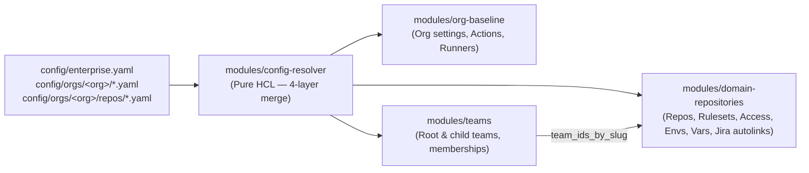

# OpenTofu Modules (`modules/`)

This directory contains the **Hardened IaC Engine** that translates declarative YAML configurations (`config/`) into **GitHub Enterprise Cloud (GHEC)** resources using the [`integrations/github`](https://registry.opentofu.org/providers/integrations/github/latest/docs) provider.

Maintainers working on day-to-day repository or team changes only need to edit `config/`. Platform Engineers author and maintain the modules here.

---

## Module Architecture & Data Flow

---

## Module Catalog

| Module | Responsibility | Resources Managed |
| :--- | :--- | :--- |
| [`config-resolver/`](./config-resolver/README.md) | Loads YAML files and resolves the 4-layer inheritance hierarchy (`Enterprise Archetype` → `Org` → `Domain` → `Repository`). | None (pure HCL data transformation). |
| [`enterprise-baseline/`](./enterprise-baseline/README.md) | Manages Enterprise-scoped resources and policy ceiling summaries from `config/enterprise.yaml`. | `data.github_enterprise`, `github_enterprise_actions_runner_group` |
| [`org-baseline/`](./org-baseline/README.md) | Applies organization-wide security dials, GitHub Actions token policies, and runner groups. | `github_organization_settings`, `github_actions_organization_permissions`, `github_actions_runner_group` |
| [`teams/`](./teams/README.md) | Creates centralized GitHub Teams in two passes (root teams, then child teams) and manages memberships. | `github_team`, `github_team_membership` |
| [`domain-repositories/`](./domain-repositories/README.md) | Provisions repositories, modern Repository Rulesets, team permissions, deployment environments, non-sensitive Actions variables, and optional Jira autolinks. | `github_repository`, `github_repository_ruleset`, `github_team_repository`, `github_repository_environment`, `github_actions_variable`, `github_repository_autolink_reference` |

---

## Authoring Standards

1. **Enforce Tier 1 Invariants in HCL**: Use `validation {}` blocks and hardcoded baseline attributes (e.g., `archive_on_destroy = true`, `default_workflow_permissions = "read"`, no `visibility = "public"`, no `permission = "admin"`).
2. **Trace Every Resource to a YAML Dial**: Add concise inline comments above resources explaining which YAML field in `config/` controls them.
3. **Keep Modules Small & Focused**: Group related resources into logical files (`main.tf`, `branch_protection.tf`, `team_access.tf`, `environments.tf`).
4. **Validate Before Committing**: Run `./scripts/validate.sh` from the repository root to check formatting, HCL validation, and Tier 1 invariants.
5. **AI Coaching Skill**: Platform Engineers and AI assistants should follow [`.agents/skills/author-github-module/SKILL.md`](../.agents/skills/author-github-module/SKILL.md) and [`modules/AGENTS.md`](./AGENTS.md).
